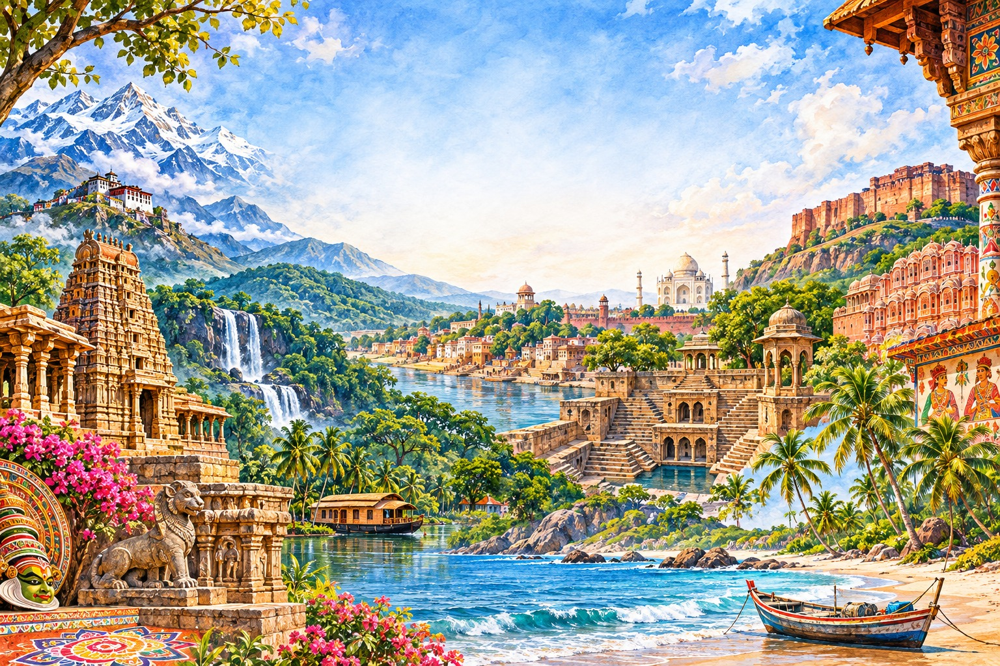

# INDIA — Complete Country Encyclopedia

**GyanBhoomi World General Knowledge | Country 001 | Research edition: 12 November 2026**

> **Editorial note:** This is a detailed reference article, not a claim that every village, person, event or local custom in India can be exhaustively listed in one page. The article covers the national framework and major regional variations. Figures are dated and attributed. Census counts, estimates, legal facts and cultural conventions are not interchangeable.

*Cover-art note: This is original AI-generated illustrative artwork representing a composite of Indian landscapes and architecture. It is not a documentary photograph, a geographically exact panorama or a map.*

---

## 1. Country overview and identity

### 1.1 Basic country profile

| Item | Detail |
|---|---|
| Common name | India |
| Official name | Republic of India; in Hindi, भारत गणराज्य (Bhārat Gaṇarājya) |
| Constitutional description | “India, that is Bharat, shall be a Union of States.” — Article 1 |
| Capital | New Delhi |
| Largest urban agglomeration | Delhi (population definitions vary by dataset and year) |
| Region | South Asia |
| Subregion in UN statistics | Southern Asia |
| Area | 3,287,263 km² |
| Approximate north–south extent | 3,214 km |
| Approximate east–west extent | 2,933 km |
| Coastline | About 7,516.6 km including island territories; measurement varies by method |
| Currency | Indian rupee (₹), ISO code INR |
| Time zone | Indian Standard Time (IST), UTC+5:30 |
| Calling code | +91 |
| Internet country code | .in |
| Driving side | Left |
| Government | Sovereign, socialist, secular, democratic republic; parliamentary system |
| Independence | 15 August 1947 |
| Constitution came into force | 26 January 1950 |
| UN membership | 30 October 1945; India was an original member |
| Current administrative structure | 28 states and 8 union territories |
| Official language of the Union | Hindi in Devanagari script; English continues to be used for official purposes under law |
| National anthem | Jana Gana Mana |
| National song | Vande Mataram |
| National motto | Satyameva Jayate (“Truth alone triumphs”) |
| National calendar | Saka Calendar, used with the Gregorian calendar for specified official purposes |

**Area caution:** The official national area figure is 3,287,263 km². International publications may show slightly different totals because of measurement, boundary and territorial-accounting conventions.

### 1.2 Name and identity

The Constitution uses the expression “India, that is Bharat”. “India” is the internationally familiar English name; “Bharat” is an ancient name used in Indian literary, cultural and constitutional contexts. The word “Hindustan” has also been used historically and culturally, but it is not the formal name specified in Article 1.

India is a union of states with a federal constitutional structure and a strong Union government. It is also one of the world's most linguistically, religiously and culturally diverse countries. National unity is organised through constitutional citizenship and institutions rather than through a single language, religion or ethnic identity.

### 1.3 Flag

The National Flag is a horizontal tricolour of deep saffron at the top, white in the middle and India green at the bottom, with a navy-blue Ashoka Chakra of 24 spokes at the centre of the white band.

- **Saffron:** commonly explained as representing courage and sacrifice.
- **White:** associated with peace and truth.
- **Green:** associated with fertility, growth and auspiciousness.
- **Ashoka Chakra:** the wheel of dharma, motion and righteous conduct; its 24 spokes are part of the flag's prescribed design.

The Constituent Assembly adopted the National Flag on 22 July 1947. The Flag Code of India and relevant standards govern its display and manufacture.

### 1.4 National emblem

The State Emblem of India is adapted from the Lion Capital of Ashoka at Sarnath. The official emblem shows three lions visible in the two-dimensional representation, with the wheel, a bull and a horse in the abacus design; the motto “Satyameva Jayate” appears below in Devanagari. The original sculpture has four lions standing back to back.

### 1.5 National identity elements

| Element | Official position |
|---|---|
| National anthem | Jana Gana Mana, composed by Rabindranath Tagore; adopted 24 January 1950 |
| National song | Vande Mataram, composed by Bankim Chandra Chatterjee |
| National animal | Bengal tiger |
| National bird | Indian peafowl (peacock) |
| National flower | Lotus |
| National tree | Banyan |
| National fruit | Mango |
| National aquatic animal | Ganges river dolphin |
| National river | Ganga is commonly identified in government educational material as the national river |
| National heritage animal | Indian elephant |
| National calendar | Saka calendar |
| National motto | Satyameva Jayate |

**Important distinction:** Some commonly circulated lists label symbols such as the national game or national language. India has no officially declared national game, and it has no single “national language” under the Constitution. Hindi is the official language of the Union under Article 343; English continues for official purposes under the Official Languages Act. The Constitution recognises 22 languages in the Eighth Schedule.

---

## 2. Geography

### 2.1 Location and extent

India lies in the northern hemisphere, mainly between latitudes 8°4′ N and 37°6′ N and longitudes 68°7′ E and 97°25′ E, with island territories extending farther south. The Tropic of Cancer crosses the country. The Indian mainland projects southward into the Indian Ocean, with the Arabian Sea to the west and the Bay of Bengal to the east.

India's location gives it a central position in the northern Indian Ocean. It is connected historically to West Asia, Africa, Europe, Southeast Asia and East Asia through maritime routes, monsoon navigation and overland corridors.

### 2.2 Neighbouring countries

India shares land boundaries with Pakistan, Afghanistan (as described in India's official territorial position), China, Nepal, Bhutan, Bangladesh and Myanmar. It has maritime neighbours including Sri Lanka and the Maldives. Boundary descriptions involving disputed territories should be read with the relevant governments' stated positions; maps must follow official Survey of India publications and applicable law.

### 2.3 Major physical divisions

1. **The Himalayan mountain system:** A young fold-mountain system in the north, including the Greater Himalaya, Lesser Himalaya and Shiwalik ranges. It influences climate, rivers, biodiversity and national security.
2. **The Northern Plains:** Formed largely by alluvial deposits of the Indus, Ganga and Brahmaputra river systems. These plains contain fertile soils and dense settlement.
3. **The Peninsular Plateau:** An ancient geological region including the Central Highlands and Deccan Plateau. It contains mineral resources and major river basins.
4. **The Indian Desert:** The Thar Desert in the northwest, with arid conditions, dunes and sparse vegetation.
5. **The Coastal Plains:** Western and Eastern coastal plains along the Arabian Sea and Bay of Bengal, with deltas, estuaries, lagoons and ports.
6. **The Islands:** The Andaman and Nicobar Islands in the Bay of Bengal and Lakshadweep in the Arabian Sea. They have distinctive marine and terrestrial ecosystems.

### 2.4 Mountain ranges and peaks

- **Himalaya:** A vast mountain arc along the north.
- **Karakoram:** High mountain system in the far north, including some of the world's highest peaks and glaciers.
- **Aravalli Range:** One of the world's very old fold mountain systems, extending through Rajasthan toward Delhi.
- **Vindhya Range:** A series of hills and plateaus in central India, historically important as a regional geographic marker.
- **Satpura Range:** Central Indian highlands between the Narmada and Tapti systems.
- **Western Ghats:** Mountain chain parallel to the western coast; a global biodiversity hotspot.
- **Eastern Ghats:** Discontinuous hills along eastern India.
- **Nilgiri Hills:** Meeting region of the Western and Eastern Ghats.
- **Anamudi:** Commonly recognised as the highest peak in peninsular India (about 2,695 m).
- **Kangchenjunga:** 8,586 m, on the India–Nepal border; the highest peak associated with India's international boundary and the world's third-highest mountain.

### 2.5 Major rivers

**Himalayan river systems**
- **Indus system:** Indus and tributaries such as Jhelum, Chenab, Ravi, Beas and Sutlej. Several rivers cross international boundaries and are governed by treaties and agreements.
- **Ganga system:** Ganga and tributaries including Yamuna, Ghaghara, Gandak, Kosi, Son and others. It supports a vast population and extensive agriculture.
- **Brahmaputra system:** Enters India through Arunachal Pradesh, flows through Assam and continues into Bangladesh. It carries large sediment loads and is prone to seasonal flooding.

**Peninsular rivers**
- **Godavari:** Often called the Dakshin Ganga; India's longest peninsular river.
- **Krishna:** Important for irrigation, hydropower and delta agriculture.
- **Kaveri (Cauvery):** Important southern river with a basin shared by multiple states.
- **Mahanadi:** Flows through central-eastern India and forms a delta in Odisha.
- **Narmada:** Flows westward through a rift valley into the Arabian Sea.
- **Tapti (Tapi):** Another major west-flowing river.
- **Sabarmati, Mahi, Periyar, Brahmani and Subarnarekha:** Important regional river systems.

### 2.6 Lakes, wetlands and water bodies

- **Wular Lake:** Important freshwater lake in Jammu and Kashmir.
- **Dal Lake:** Famous urban lake in Srinagar.
- **Chilika Lake:** Brackish lagoon in Odisha and an important bird habitat.
- **Loktak Lake:** Manipur's largest freshwater lake, known for floating phumdis.
- **Sambhar Lake:** India's largest inland salt lake, in Rajasthan.
- **Vembanad Lake:** Large lake system in Kerala.
- **Pulicat Lake:** Brackish lagoon shared by Andhra Pradesh and Tamil Nadu.
- **Lake Pichola:** Historic lake in Udaipur.
- **Kolleru Lake:** Freshwater lake in Andhra Pradesh.
- **Sasthamkotta Lake:** Freshwater lake in Kerala.

### 2.7 Climate and seasons

India's climate is strongly influenced by the Himalaya, the Indian Ocean, seasonal pressure systems and monsoon circulation.

- **Cold weather season:** broadly December to February in much of northern India, though regional variation is large.
- **Hot weather/pre-monsoon season:** broadly March to May or early June.
- **Southwest monsoon:** usually begins over Kerala around the start of June and advances across the country; timing varies year to year.
- **Retreating/northeast monsoon:** especially important for Tamil Nadu and parts of southeastern India, generally during October–December.

The India Meteorological Department uses operational seasons and regional subdivisions; these broad textbook labels should not be treated as exact dates for every location.

### 2.8 Soils

Major soil groups include alluvial, black (regur), red and yellow, laterite, arid/desert, forest and mountain soils, saline/alkaline soils and peaty/marshy soils. Soil type influences crops, irrigation needs, settlement and land management.

### 2.9 Natural resources

India has deposits of coal, iron ore, bauxite, manganese, limestone, chromite, mica, copper, zinc, rare earth minerals and other resources. Petroleum and natural gas are produced in onshore and offshore fields. Resource distribution is uneven, and extraction creates environmental, social and land-use questions.

### 2.10 Natural hazards

India is exposed to earthquakes, floods, cyclones, droughts, landslides, heatwaves, cold waves, lightning, forest fires and coastal erosion. Risk differs by region: Himalayan states face seismic and landslide hazards; eastern and western coasts face cyclones; river plains face floods; arid and semi-arid regions face drought and heat stress.

---

## 3. Population, people and languages

### 3.1 Population: census versus estimate

- **UNData 2025 estimate:** 1,463,866,000 people (about 1.464 billion).
- **World Bank 2025 population series:** about 1.46 billion.
- **Last completed decennial census:** Census 2011.
- **Census 2011 population:** 1,210,854,977 (about 1.211 billion).

The 2025 value is an estimate, not the result of a completed 2025 census. The Registrar General and Census Commissioner of India identifies 2011 as the last completed population census in the published census series consulted for this article. Always show the reference year and whether a number is a census count or estimate.

### 3.2 Population distribution

Population is unevenly distributed. The Indo-Gangetic plains, coastal belts, river valleys and major metropolitan corridors are densely populated. Himalayan highlands, deserts, forests and some island areas are more sparsely populated. Urbanisation has expanded around Delhi, Mumbai, Kolkata, Chennai, Bengaluru, Hyderabad, Ahmedabad, Pune, Surat, Jaipur, Lucknow, Kochi and many other cities.

### 3.3 Major urban centres

Important urban centres include:
- Delhi / New Delhi — national capital region and major administrative, commercial and transport hub.
- Mumbai — financial, commercial, film and port city.
- Kolkata — historic eastern metropolis and cultural centre.
- Chennai — major southern port, manufacturing and cultural centre.
- Bengaluru — technology, research, aerospace and startup hub.
- Hyderabad — technology, pharmaceuticals, research and heritage.
- Ahmedabad — major commercial and industrial centre in Gujarat.
- Pune — education, manufacturing and information technology.
- Surat — diamond processing, textiles and trade.
- Jaipur — state capital and heritage tourism centre.
- Lucknow — administrative and cultural centre of Uttar Pradesh.
- Kochi — port, trade, tourism and maritime hub.
- Visakhapatnam — major port and industrial city.
- Bhopal, Indore, Nagpur, Patna, Guwahati, Bhubaneswar, Chandigarh, Srinagar and Thiruvananthapuram are important regional centres.

City rankings depend on whether one counts municipal limits, urban agglomerations or metropolitan regions.

### 3.4 Languages

The Constitution's Eighth Schedule recognises 22 languages:
1. Assamese
2. Bengali
3. Bodo
4. Dogri
5. Gujarati
6. Hindi
7. Kannada
8. Kashmiri
9. Konkani
10. Maithili
11. Malayalam
12. Manipuri (Meitei)
13. Marathi
14. Nepali
15. Odia
16. Punjabi
17. Sanskrit
18. Santali
19. Sindhi
20. Tamil
21. Telugu
22. Urdu

India has hundreds of languages and many more mother-tongue varieties. The 22 scheduled languages are not the full list of languages spoken in India. Census language classifications group mother tongues using defined criteria; language identity is complex and sometimes politically sensitive.

### 3.5 Religion and society

India is constitutionally secular and protects freedom of conscience and religion, subject to constitutional limitations. The population includes Hindus, Muslims, Christians, Sikhs, Buddhists, Jains, Zoroastrians, Jews, followers of Indigenous and local traditions, and people with no religious affiliation. The Constitution does not establish a state religion.

### 3.6 Social diversity

Indian society includes many caste, community, tribal, linguistic, regional and occupational identities. Scheduled Castes and Scheduled Tribes are constitutional categories used for protections and affirmative measures. Other Backward Classes are recognised under relevant legal and policy frameworks. These categories should not be treated as interchangeable with religion, language or ethnicity.

### 3.7 Migration and diaspora

Internal migration occurs for work, education, marriage, seasonal agriculture, construction and family reasons. The Indian diaspora is spread across the Gulf states, North America, the United Kingdom, Africa, Southeast Asia, Oceania and other regions. Diaspora communities contribute through remittances, business, research, culture and diplomacy.

---

## 4. History: detailed chronological timeline

### 4.1 Prehistory and early human settlement

Archaeological evidence indicates very ancient human presence in the Indian subcontinent. Stone tools, rock shelters, cave art and settlement remains reveal changing technologies, food systems and cultural practices. Evidence varies by region and period; no single site represents the entire subcontinent.

### 4.2 Indus or Harappan Civilisation (c. 2600–1900 BCE, Mature phase)

The Indus Civilisation developed across parts of present-day Pakistan and northwestern India. Major sites include Harappa, Mohenjo-daro, Dholavira, Rakhigarhi, Lothal, Kalibangan and Ganweriwala.
Key characteristics:
- Planned urban settlements and street grids.
- Drainage systems and water management.
- Standardised weights and measures.
- Craft production, bead-making, pottery and metallurgy.
- Long-distance trade networks.
- A script that remains undeciphered by consensus.
- Regional variation and changing settlement patterns.

The civilisation did not simply “vanish” in one event. Its urban system transformed over time through multiple environmental, economic and social processes.

### 4.3 Vedic and later Vedic periods (broadly c. 1500–600 BCE)

The Vedic corpus is a major source for early Indo-Aryan language, ritual, poetry and social history. The period saw changes in settlement, agriculture, political organisation and religious thought. Historians debate chronology and interpretation; literary traditions should be read alongside archaeology and linguistic research.

### 4.4 Mahajanapadas and new religious movements (c. 600–300 BCE)

Northern India saw the growth of larger states and republic-like political formations known as mahajanapadas. This era was associated with urbanisation, coinage, trade, philosophical debate and the emergence of major śramaṇa traditions. Gautama Buddha and Mahavira are central figures in the histories of Buddhism and Jainism.

### 4.5 Maurya Empire (c. 322–185 BCE)

Chandragupta Maurya founded the Maurya Empire. Bindusara succeeded him, followed by Ashoka. After the Kalinga war, Ashoka promoted dhamma through inscriptions and supported Buddhist institutions. Mauryan administration, roads, trade and imperial communication left a major historical legacy. Ashokan pillars and inscriptions are important sources for reconstructing this period.

### 4.6 Post-Mauryan and classical age

The subcontinent experienced multiple regional powers and networks, including Indo-Greek, Shaka, Kushan, Satavahana and other dynasties. The Gupta period (roughly fourth to sixth centuries CE) is associated with major developments in Sanskrit literature, mathematics, astronomy, sculpture and political culture, though the term “Golden Age” is debated and should not obscure regional differences or social inequalities.

### 4.7 Early medieval regional kingdoms

Important powers included the Chalukyas, Pallavas, Rashtrakutas, Cholas, Pandyas, Palas, Pratiharas, Gurjara-Pratiharas, Kashmir's dynasties, and many others. Temple construction, regional languages, maritime trade, agrarian expansion and devotional movements developed in varied ways.

### 4.8 Delhi Sultanate (1206–1526)

The Delhi Sultanate included the Mamluk, Khalji, Tughlaq, Sayyid and Lodi dynasties. It shaped political, military, administrative, architectural and cultural developments across northern India. The Sultanate interacted with regional kingdoms and did not control all of the subcontinent uniformly.

### 4.9 Mughal Empire (from 1526)

Babur established Mughal rule after the First Battle of Panipat in 1526. Major rulers included Humayun, Akbar, Jahangir, Shah Jahan and Aurangzeb. The empire developed complex revenue systems, court culture, architecture, painting and diplomacy. Mughal power expanded and contracted over time; regional states became increasingly influential in the eighteenth century.

### 4.10 Regional powers and eighteenth-century change

The Marathas, Sikhs, Mysore under Haidar Ali and Tipu Sultan, the Nizams of Hyderabad, Awadh, Bengal and many other states shaped the political landscape. European trading companies expanded their military and territorial influence.

### 4.11 European colonial expansion and British rule

The English East India Company gained political power after the Battle of Plassey (1757) and the Battle of Buxar (1764), among other events. British rule expanded through conquest, treaties, annexation and administrative control. The uprising of 1857 was a major anti-colonial rebellion; after it, the British Crown assumed direct rule in 1858.

Colonial rule transformed land revenue, law, transport, education, industry and trade. It also involved economic extraction, famine, racial hierarchy and political repression. The impact varied by region and social group.

### 4.12 Indian national movement

Major developments and movements included:
- Formation of the Indian National Congress in 1885.
- Swadeshi movement after the 1905 partition of Bengal.
- Home Rule movements.
- Champaran, Kheda and Ahmedabad labour struggles.
- Rowlatt Act protests and Jallianwala Bagh massacre (1919).
- Non-Cooperation Movement (1920–22).
- Civil Disobedience Movement and Salt March (1930).
- Government of India Act 1935.
- Quit India Movement (1942).
- Naval ratings' revolt and other late-colonial pressures.
- Negotiations, communal violence and partition in 1947.

Leaders and participants included Mahatma Gandhi, Jawaharlal Nehru, Sardar Vallabhbhai Patel, Subhas Chandra Bose, Maulana Abul Kalam Azad, B. R. Ambedkar, Sarojini Naidu, Bhagat Singh, Chandrashekhar Azad, Lala Lajpat Rai, Bal Gangadhar Tilak, Gopal Krishna Gokhale, Annie Besant, Aruna Asaf Ali, Khan Abdul Ghaffar Khan and many regional, labour, peasant, tribal and women's movement leaders.

### 4.13 Independence and Partition (1947)

British rule ended on 15 August 1947. Partition created India and Pakistan and caused enormous displacement, violence and loss of life. Princely states were integrated through political negotiations, accession and, in some cases, conflict. The process of integration involved Sardar Vallabhbhai Patel, V. P. Menon and many regional leaders and officials.

### 4.14 Constitution and Republic (1950)

The Constituent Assembly adopted the Constitution on 26 November 1949. It came into force on 26 January 1950, making India a republic. Dr B. R. Ambedkar chaired the Drafting Committee. The Constitution established parliamentary government, fundamental rights, directive principles, federal institutions, an independent judiciary and universal adult franchise.

### 4.15 Post-independence milestones

- 1950s: consolidation of parliamentary institutions and planning.
- 1956: major reorganisation of states on linguistic lines.
- 1962: war with China.
- 1965: war with Pakistan.
- 1966: Indira Gandhi became Prime Minister.
- 1971: war leading to the creation of Bangladesh.
- 1974: Pokhran-I nuclear test, code-named Smiling Buddha.
- 1975–1977: Emergency.
- 1984: Operation Blue Star, assassination of Indira Gandhi and anti-Sikh violence.
- 1991: economic reforms and liberalisation; major balance-of-payments crisis.
- 1998: Pokhran-II nuclear tests.
- 1999: Kargil conflict.
- 2000: creation of Chhattisgarh, Uttarakhand and Jharkhand.
- 2005: Right to Information Act.
- 2008: launch of Chandrayaan-1; global financial crisis period.
- 2014: formation of Telangana as a state.
- 2016: demonetisation of specified banknotes.
- 2017: Goods and Services Tax (GST) rollout.
- 2019: constitutional changes concerning Jammu and Kashmir and creation of the Union Territories of Jammu and Kashmir and Ladakh.
- 2020: COVID-19 pandemic and nationwide public-health and economic effects.
- 2023: G20 Leaders' Summit hosted in New Delhi; Chandrayaan-3 soft-landed near the lunar south polar region.
- 2024–2026: continuing developments in elections, public policy, infrastructure, technology, diplomacy and space; update these dynamically with dated sources.

---

## 5. Government, Constitution and administration

### 5.1 Constitutional framework

The Constitution is the supreme law of India. It establishes India as a sovereign, socialist, secular, democratic republic and provides for a parliamentary system. It contains a Preamble, Parts, Articles and Schedules, and has been amended many times. Article numbering and inserted provisions can make simple “total article” counts misleading; use the latest official consolidated text.

### 5.2 Fundamental constitutional features

- Parliamentary form of government.
- Federal structure with a strong Union.
- Written Constitution and constitutional supremacy.
- Independent judiciary and judicial review.
- Fundamental Rights.
- Directive Principles of State Policy.
- Fundamental Duties.
- Universal adult suffrage.
- Secular constitutional framework.
- Single citizenship.
- Emergency provisions.
- Local self-government through Panchayats and Municipalities.
- Special provisions for certain states and areas.

### 5.3 Fundamental Rights (Part III)

The Constitution protects rights including:
- Equality before law and equal protection of laws.
- Prohibition of discrimination on specified grounds.
- Equality of opportunity in public employment.
- Abolition of untouchability.
- Abolition of titles, subject to constitutional exceptions.
- Freedoms under Article 19, subject to reasonable restrictions.
- Protection in respect of conviction for offences.
- Protection of life and personal liberty under Article 21.
- Rights concerning education under Article 21A.
- Protection against exploitation.
- Freedom of religion.
- Cultural and educational rights.
- Constitutional remedies under Article 32.

Rights are subject to constitutional text, judicial interpretation and lawful restrictions. The right to property is now a constitutional/legal right under Article 300A, not a Fundamental Right.

### 5.4 Directive Principles and Fundamental Duties

Directive Principles (Part IV) guide the state in making policy; they are not directly enforceable by courts in the same way as Fundamental Rights. Fundamental Duties are listed in Part IVA, Article 51A.

### 5.5 Union executive

- **President:** constitutional head of the Union; elected indirectly through an electoral college.
- **Vice-President:** ex officio Chairperson of the Rajya Sabha.
- **Prime Minister:** head of the Council of Ministers and central political executive.
- **Council of Ministers:** collectively responsible to the Lok Sabha.
- **Attorney General of India:** chief legal adviser to the Union government.

Names of officeholders change; they should be maintained in a separate “current officeholders” data block with a last-verified date.

### 5.6 Parliament

India's Parliament consists of the President and two Houses:
- **Lok Sabha:** House of the People; directly elected, subject to constitutional and statutory rules.
- **Rajya Sabha:** Council of States; a permanent House with members retiring in rotation.

Parliament makes laws, approves taxation and expenditure, debates national issues, oversees the executive and performs constitutional functions. Money Bills have special procedures.

### 5.7 Judiciary

- **Supreme Court of India:** highest court; constitutional, appellate and advisory jurisdiction.
- **High Courts:** highest courts at the state or regional level.
- **Subordinate courts:** district and lower courts.
- **Constitutional bodies and tribunals:** operate under specific legal frameworks.

The judiciary interprets the Constitution, reviews executive and legislative action, and adjudicates disputes.

### 5.8 States and Union Territories

India has 28 states and 8 Union Territories. Capital conventions can be seasonal, shared or administratively complex; the list below gives the commonly used principal capital.

**28 States**

| State | Capital |
|---|---|
| Andhra Pradesh | Amaravati |
| Arunachal Pradesh | Itanagar |
| Assam | Dispur |
| Bihar | Patna |
| Chhattisgarh | Raipur |
| Goa | Panaji |
| Gujarat | Gandhinagar |
| Haryana | Chandigarh |
| Himachal Pradesh | Shimla (Dharamshala is second capital) |
| Jharkhand | Ranchi |
| Karnataka | Bengaluru |
| Kerala | Thiruvananthapuram |
| Madhya Pradesh | Bhopal |
| Maharashtra | Mumbai (Nagpur is winter-session second capital) |
| Manipur | Imphal |
| Meghalaya | Shillong |
| Mizoram | Aizawl |
| Nagaland | Kohima |
| Odisha | Bhubaneswar |
| Punjab | Chandigarh |
| Rajasthan | Jaipur |
| Sikkim | Gangtok |
| Tamil Nadu | Chennai |
| Telangana | Hyderabad |
| Tripura | Agartala |
| Uttar Pradesh | Lucknow |
| Uttarakhand | Dehradun (Gairsain is summer capital) |
| West Bengal | Kolkata |

**8 Union Territories**

| Union Territory | Capital / administrative seat |
|---|---|
| Andaman and Nicobar Islands | Sri Vijaya Puram (formerly Port Blair) |
| Chandigarh | Chandigarh |
| Dadra and Nagar Haveli and Daman and Diu | Daman |
| Delhi (National Capital Territory) | New Delhi |
| Jammu and Kashmir | Srinagar (summer), Jammu (winter) |
| Ladakh | Leh |
| Lakshadweep | Kavaratti |
| Puducherry | Puducherry |

**Administrative note:** State and UT boundaries, capital arrangements and district counts can change. This list should be checked against the latest Ministry of Home Affairs and state/UT government records before a site release.

### 5.9 Local government

- **Rural:** Gram Sabha, Gram Panchayat, Panchayat Samiti/Block Panchayat and Zila Parishad, with state-specific variations.
- **Urban:** Municipal corporations, municipalities and town councils.
- The 73rd and 74th Constitutional Amendments gave constitutional status to Panchayats and Municipalities.

### 5.10 Constitutional and statutory institutions

Important institutions include:
- Election Commission of India.
- Union Public Service Commission.
- Finance Commission.
- Comptroller and Auditor General of India.
- National Commission for Scheduled Castes.
- National Commission for Scheduled Tribes.
- National Commission for Backward Classes.
- Goods and Services Tax Council.
- Reserve Bank of India (statutory central bank).
- Central Information Commission.
- National Human Rights Commission.
- Central Vigilance Commission.
- Central Bureau of Investigation (created by resolution; operates under applicable legal framework).
- NITI Aayog (policy think tank established by executive resolution).

### 5.11 Elections and political parties

India conducts elections for the Lok Sabha, state legislative assemblies, local bodies and other offices. The Election Commission of India supervises elections to Parliament, state legislatures, the offices of President and Vice-President. Local-body elections are conducted by State Election Commissions. India has a multiparty system; party recognition and symbols are governed by election law and Election Commission rules.

---

## 6. Economy

### 6.1 Structure

India has a mixed economy with a large private sector, public enterprises, government spending and extensive informal economic activity. Services form the largest share of gross value added, while industry and agriculture remain vital for employment, exports, food security and regional development.

UNData's 2025 series records GDP of approximately US$3.576 trillion, GDP growth of 8.2% and GDP per capita of about US$2,487; World Bank data currently reports a different 2025 nominal GDP series (about US$3.96 trillion) and per-capita value. These are not to be blended. Differences can arise from revisions, exchange rates, national accounts vintages and release schedules. For publication, show one named source and one reference year per chart.

### 6.2 Agriculture

Major crops:
- Rice, wheat, maize, millets and pulses.
- Sugarcane, cotton, jute and oilseeds.
- Tea, coffee, spices, rubber and horticultural crops.
- Fruits and vegetables including mango, banana, citrus, apple, grapes, coconut and many regional varieties.

Agriculture depends on monsoon rainfall, irrigation, groundwater, soil health, market access, storage and farm policy. India's agricultural system includes smallholders, commercial farms, cooperatives, plantations and pastoral livelihoods.

### 6.3 Industry and manufacturing

Important sectors include:
- Textiles and garments.
- Steel, cement and construction materials.
- Automobiles and auto components.
- Pharmaceuticals and biotechnology.
- Chemicals and petrochemicals.
- Electronics and semiconductors.
- Food processing.
- Defence manufacturing.
- Renewable-energy equipment.
- Shipbuilding and engineering.

### 6.4 Services

Services include information technology, software, business-process services, finance, insurance, telecommunications, transport, logistics, retail, education, health, tourism, media and professional services.

### 6.5 Banking and monetary system

The Reserve Bank of India (RBI) is India's central bank. It issues banknotes (subject to statutory arrangements), conducts monetary policy, regulates and supervises much of the banking system, manages foreign-exchange reserves and supports payment-system stability. The rupee is divided into 100 paise, although paise coins are not commonly used for many everyday cash transactions.

### 6.6 Taxation

India's tax system includes direct taxes such as personal income tax and corporate tax, and indirect taxes such as GST, customs duties and excise duties on specified goods. GST was introduced on 1 July 2017. Tax rates and slabs change and must be checked against current legislation and official tax portals.

### 6.7 Trade and infrastructure

Major export categories include engineering goods, petroleum products, pharmaceuticals, gems and jewellery, textiles, chemicals, agricultural products and services. Imports include crude oil, electronics, machinery, gold, chemicals and other inputs. Trade partners and rankings change year to year.

Infrastructure includes national highways, state roads, railways, metro systems, ports, airports, inland waterways, power grids, digital networks and logistics corridors.

### 6.8 Economic challenges

Key challenges include employment quality, informality, regional inequality, learning outcomes, public health, urban congestion, air pollution, water stress, female labour-force participation, agricultural resilience, energy transition and climate adaptation. Strong aggregate growth does not mean all households or regions experience the same gains.

---

## 7. Culture, heritage and everyday life

### 7.1 Cultural diversity

India does not have one uniform culture. Food, dress, language, music, architecture, marriage customs, festivals and social practices vary by region, community, religion, caste, class, generation and urban/rural setting.

### 7.2 Classical dance traditions

The Sangeet Natak Akademi recognises major classical dance forms commonly taught as:
- Bharatanatyam (Tamil Nadu)
- Kathak (north India)
- Kathakali (Kerala)
- Kuchipudi (Andhra Pradesh)
- Odissi (Odisha)
- Manipuri (Manipur)
- Mohiniyattam (Kerala)
- Sattriya (Assam)

Regional folk and community dances are equally important to local cultural life; lists of classical forms should not imply that all other dance traditions are less valuable.

### 7.3 Music

Indian music includes Hindustani and Carnatic classical traditions, devotional music, folk forms, tribal music, film music, contemporary pop, rock, hip-hop and electronic music. Instruments include sitar, sarod, veena, tabla, mridangam, flute, shehnai, sarangi, dhol, nadaswaram and many regional instruments.

### 7.4 Literature and languages

Major literary traditions include Sanskrit, Tamil, Pali, Prakrit, Persian, Arabic, Urdu, Hindi, Bengali, Marathi, Gujarati, Kannada, Malayalam, Telugu, Odia, Assamese, Punjabi, Kashmiri, Manipuri, Santali and many others. Literary history spans oral epics, religious texts, court poetry, bhakti and Sufi writing, modern novels, theatre, journalism and contemporary literature.

### 7.5 Architecture

Important architectural traditions include:
- Indus urban planning.
- Buddhist stupas, chaityas and viharas.
- Rock-cut cave architecture.
- Nagara, Dravida and Vesara temple traditions.
- Indo-Islamic architecture.
- Mughal architecture.
- Rajput forts and palaces.
- Sikh gurdwara architecture.
- Colonial-era civic and railway architecture.
- Modernist and contemporary Indian architecture.

### 7.6 Food

Regional examples include:
- North: roti, paratha, dal, chole, kebabs, biryani, sarson da saag.
- West: dhokla, thepla, undhiyu, dal-baati-churma, pav bhaji, Goan fish curry.
- East: rice, fish preparations, pitha, litti-chokha, sweets such as rasgulla and sandesh.
- South: idli, dosa, sambar, rasam, appam, puttu, biryani, seafood and millet-based dishes.
- Northeast: rice-based dishes, smoked and fermented foods, bamboo shoot preparations and local greens.

These are regional examples, not fixed rules for every household or community.

### 7.7 Festivals

Major festivals include Diwali, Holi, Eid, Christmas, Gurpurab, Navratri, Durga Puja, Onam, Pongal, Bihu, Vaisakhi, Ganesh Chaturthi, Rath Yatra, Buddha Purnima, Mahavir Jayanti, Losar, Hornbill Festival, Nuakhai, Chhath Puja and many local observances. Dates may follow lunar, solar or regional calendars.

### 7.8 Clothing and textiles

Clothing traditions include sari, salwar kameez, kurta-pajama, dhoti, lungi, sherwani, lehenga, mekhela chador, phanek, traditional tribal attire and region-specific garments. Textiles include Banarasi silk, Kanchipuram silk, Paithani, Patola, Pochampally ikat, Chanderi, Jamdani, Sambalpuri, phulkari, pashmina and many handloom and craft traditions.

### 7.9 Sports

Cricket has a major following. Other sports include hockey, football, badminton, wrestling, kabaddi, athletics, boxing, shooting, chess, tennis, weightlifting, archery, table tennis and traditional games. India has produced world-class athletes and hosts major domestic and international sporting events.

---

## 8. Education, science and technology

### 8.1 Education system

Education is delivered through Union, state, local and private institutions. The system includes early childhood education, school education, secondary and higher secondary stages, vocational education, universities, colleges, technical institutions and open/distance learning. The Right of Children to Free and Compulsory Education Act provides for free and compulsory education for children aged 6–14, subject to the law's provisions.

### 8.2 Major institutions

Examples include:
- Indian Institutes of Technology (IITs).
- Indian Institutes of Management (IIMs).
- All India Institute of Medical Sciences (AIIMS).
- Indian Institute of Science (IISc).
- National Institutes of Technology (NITs).
- Indian Institutes of Science Education and Research (IISERs).
- Central universities and state universities.
- Indian Statistical Institute.
- Tata Institute of Fundamental Research.
- Council of Scientific and Industrial Research laboratories.
- Indian Council of Agricultural Research institutes.

### 8.3 Mathematics and astronomy

Indian mathematical traditions include the development and transmission of place-value notation, zero as a number, decimal methods, algebraic and trigonometric work, and major contributions by scholars such as Aryabhata, Brahmagupta, Bhaskara II, Madhava of Sangamagrama and others. Historical claims should identify the scholar, text and date rather than crediting all discoveries to a vague “ancient India”.

### 8.4 Medicine and health sciences

Ayurveda, Siddha, Unani and Yoga are important traditional systems and cultural practices. Modern Indian medical research includes pharmaceuticals, vaccines, public health, surgery, biotechnology and medical devices. Traditional systems and modern evidence-based clinical medicine should be described distinctly.

### 8.5 Space programme

The Indian Space Research Organisation (ISRO) was established in 1969; the Department of Space was established in 1972. Milestones include:
- Aryabhata, India's first satellite, launched in 1975.
- Satellite Instructional Television Experiment (SITE), an early educational satellite experiment.
- SLV-3 and the growth of indigenous launch capability.
- INSAT and IRS satellite systems.
- Chandrayaan-1 (2008), which provided important evidence of water/hydroxyl on the Moon.
- Mars Orbiter Mission (Mangalyaan, 2013 launch; Mars orbit insertion in 2014).
- Chandrayaan-2 (2019).
- Chandrayaan-3 (2023), which achieved a soft landing near the lunar south polar region.
- Aditya-L1, India's solar observatory mission, placed in a halo orbit around the Sun–Earth L1 point in 2024.
- SPADEX, which demonstrated in-space docking and undocking in 2025, making India the fourth country to demonstrate docking in space according to ISRO.
- NISAR, the joint ISRO–NASA Earth-observation mission, launched in 2025.

ISRO's 2025–26 achievements also include NISAR operations and the first Indian astronaut to visit the International Space Station as part of Axiom Mission 4: Group Captain Shubhanshu Shukla. Mission status must be updated from ISRO's latest official release rather than relying on old plans.

### 8.6 Digital technology

India has developed large-scale digital public infrastructure, including Aadhaar identity infrastructure, UPI digital payments, DigiLocker, CoWIN and other government digital services. Each system has its own legal basis, governance and privacy/security considerations; do not describe them as a single database.

### 8.7 Defence technology

India's defence ecosystem includes the Army, Navy, Air Force, Coast Guard, DRDO, public-sector defence companies, private industry and research institutions. Programmes include missiles, aircraft, naval platforms, radar, electronic warfare, satellites and indigenous manufacturing. Technical performance and operational details should be sourced from official public information and not inferred.

---

## 9. Tourism, monuments and natural wonders

### 9.1 UNESCO World Heritage

UNESCO's India country page lists 45 inscribed properties at the time of research for this edition. The list includes cultural and natural properties, with new inscriptions and extensions changing the total. Examples include:
- Taj Mahal.
- Agra Fort.
- Ajanta Caves.
- Ellora Caves.
- Sun Temple, Konark.
- Group of Monuments at Hampi.
- Group of Monuments at Mahabalipuram.
- Great Living Chola Temples.
- Qutb Minar and its Monuments.
- Red Fort Complex.
- Jaipur City.
- Historic City of Ahmadabad.
- Rani-ki-Vav.
- Dholavira.
- Sanchi.
- Kaziranga National Park.
- Sundarbans National Park.
- Western Ghats.
- Great Himalayan National Park Conservation Area.
- Khangchendzonga National Park.
- Maratha Military Landscapes of India (2025 inscription).

The exact live list should be linked to UNESCO because it changes.

### 9.2 Major monuments and historic cities

- Taj Mahal, Agra.
- Red Fort, Delhi.
- Qutb Minar, Delhi.
- Humayun's Tomb, Delhi.
- India Gate and Rashtrapati Bhavan, New Delhi.
- Hawa Mahal and Amber Fort, Jaipur.
- Mehrangarh Fort, Jodhpur.
- Chittorgarh Fort, Rajasthan.
- Sanchi Stupa, Madhya Pradesh.
- Khajuraho temples, Madhya Pradesh.
- Konark Sun Temple, Odisha.
- Jagannath Temple, Puri.
- Brihadisvara Temple, Thanjavur.
- Meenakshi Amman Temple, Madurai.
- Charminar, Hyderabad.
- Gol Gumbaz, Vijayapura.
- Gateway of India, Mumbai.
- Victoria Memorial, Kolkata.
- Basilica of Bom Jesus, Goa.
- Rani-ki-Vav, Patan.
- Dholavira and Lothal archaeological sites, Gujarat.

### 9.3 Natural attractions

- Himalaya and high-altitude valleys.
- Kashmir Valley and Ladakh landscapes.
- Valley of Flowers.
- Great Rann of Kutch.
- Thar Desert.
- Sundarbans mangrove ecosystem.
- Kaziranga grasslands.
- Western Ghats forests.
- Chilika Lagoon.
- Loktak Lake.
- Andaman and Nicobar coral reefs.
- Lakshadweep atolls.
- Periyar and other Western Ghats reserves.
- Living root bridges of Meghalaya.
- Athirappilly Falls and other regional waterfalls.
- Himalayan glaciers and high mountain lakes.

### 9.4 National parks and wildlife reserves

Important examples include Jim Corbett, Kaziranga, Gir, Ranthambore, Kanha, Bandhavgarh, Pench, Sundarbans, Periyar, Nagarhole, Bandipur, Hemis, Great Himalayan, Keoladeo, Manas, Similipal, Tadoba, Dudhwa, Silent Valley and Namdapha. India has many more national parks, wildlife sanctuaries, conservation reserves and tiger reserves; a complete current inventory should be maintained as a separate searchable dataset sourced from the Ministry of Environment, Forest and Climate Change and the National Tiger Conservation Authority.

---

## 10. National identity, institutions and international relations

### 10.1 International memberships

India is a member of the United Nations and participates in many multilateral institutions, including the G20, BRICS, Shanghai Cooperation Organisation, Commonwealth, World Trade Organization, International Monetary Fund, World Bank Group, International Solar Alliance and regional groupings. Membership and status differ by organisation and should be checked individually.

### 10.2 Foreign policy themes

Major themes include strategic autonomy, neighbourhood relations, maritime security, trade, energy security, diaspora engagement, development partnerships, climate diplomacy and participation in multilateral institutions. India's relations with neighbouring countries have both cooperation and disputes; an encyclopedia should present each relationship with context and dated facts.

### 10.3 Armed forces

The Indian Armed Forces comprise:
- Indian Army.
- Indian Navy.
- Indian Air Force.

The President is the Supreme Commander under the Constitution. The Ministry of Defence manages defence policy and administration. The Coast Guard is a separate armed force under the Ministry of Defence, with maritime law-enforcement and search-and-rescue roles. The armed forces' history includes major wars, peacekeeping and disaster-response operations.

### 10.4 National days

- **26 January — Republic Day:** marks the Constitution coming into force in 1950.
- **15 August — Independence Day:** marks independence in 1947.
- **2 October — Gandhi Jayanti:** birth anniversary of Mohandas Karamchand Gandhi.
- **14 November — Children's Day:** observed on Jawaharlal Nehru's birth anniversary.
- **31 October — National Unity Day:** observed on Sardar Vallabhbhai Patel's birth anniversary.
- **National Voters' Day — 25 January:** marks the establishment of the Election Commission of India in 1950.

---

## 11. Environment, biodiversity and conservation

### 11.1 Biodiversity

India includes parts of four global biodiversity hotspots: Himalaya, Indo-Burma, Western Ghats–Sri Lanka and Sundaland (Nicobar Islands). Ecosystems range from alpine meadows and temperate forests to tropical rainforests, grasslands, deserts, mangroves, coral reefs and wetlands.

### 11.2 Iconic wildlife

- Bengal tiger.
- Asiatic lion.
- Asian elephant.
- One-horned rhinoceros.
- Snow leopard.
- Red panda.
- Ganges river dolphin.
- Lion-tailed macaque.
- Nilgiri tahr.
- Great Indian bustard.
- Gharial.
- Olive ridley sea turtle.
- Hangul (Kashmir stag).
- Blackbuck.
- Indian wild ass.

### 11.3 Conservation institutions and programmes

Important programmes include Project Tiger, Project Elephant, crocodile conservation initiatives, species recovery programmes, biosphere reserves, national parks, wildlife sanctuaries, community conservation and coastal/marine protected areas. Conservation outcomes depend on habitat connectivity, community participation, enforcement, science and conflict mitigation.

### 11.4 Environmental pressures

Air pollution, water pollution, groundwater depletion, river degradation, solid waste, plastic pollution, deforestation, habitat fragmentation, human–wildlife conflict, soil erosion, desertification, invasive species, heat stress, glacier change and coastal erosion are major challenges.

### 11.5 Climate change

India is vulnerable to heatwaves, erratic monsoon rainfall, extreme precipitation, glacial change, sea-level rise, coastal flooding and changes in agricultural productivity. Adaptation includes heat action plans, resilient infrastructure, water management, early-warning systems, ecosystem restoration and climate-resilient agriculture.

---

## 12. Education, public health, transport and infrastructure

### 12.1 Public health

India's health system includes public and private providers, primary health centres, community health centres, district hospitals, medical colleges, national institutes and private hospitals. Major public-health issues include infectious diseases, maternal and child health, nutrition, non-communicable diseases, mental health, sanitation, air pollution and unequal access to care.

### 12.2 Transport

- **Railways:** Indian Railways is one of the world's largest rail networks by size and passenger activity.
- **Roads:** National highways, state highways, district roads and rural roads connect the country.
- **Airports:** Major hubs include Delhi, Mumbai, Bengaluru, Hyderabad, Chennai and Kolkata, alongside many regional airports.
- **Ports:** Major ports include Deendayal (Kandla), Mumbai, Jawaharlal Nehru Port, Mormugao, New Mangalore, Cochin, Chennai, Kamarajar, V.O. Chidambaranar, Visakhapatnam, Paradip and Syama Prasad Mookerjee Port (Kolkata-Haldia system).
- **Metro rail:** Urban metro systems operate in several cities and continue to expand.
- **Inland waterways:** The Ganga–Bhagirathi–Hooghly, Brahmaputra and other waterways are part of inland water transport development.

### 12.3 Energy

India's energy mix includes coal, oil, natural gas, hydroelectricity, nuclear power, solar, wind, biomass and other renewables. Energy security, affordability, grid reliability, storage and decarbonisation are major policy issues.

---

## 13. Important records and notable achievements

- India is the world's largest democracy by electorate size.
- India is the world's most populous country according to current UN population estimates.
- India has one of the world's largest railway systems.
- India is a major producer of milk, pulses, rice, wheat, tea, spices and many horticultural products.
- India's film industries produce films in many languages; Hindi cinema is only one part of this wider ecosystem.
- India became the first country to soft-land a spacecraft near the Moon's south polar region with Chandrayaan-3 in 2023.
- India demonstrated in-space docking through SPADEX in 2025, according to ISRO.
- India's Aditya-L1 is its first dedicated solar observatory mission.
- India's Constitution is among the world's longest written national constitutions.
- India has 22 constitutionally scheduled languages.
- India's UNESCO World Heritage list has 45 inscribed properties on the live country page consulted for this edition.
- The Indian Ocean is named after India, reflecting the country's central position in the northern Indian Ocean region.

Records should be periodically checked; “largest”, “first” and “oldest” claims require precise definitions and dated sources.

---

## 14. Full General Knowledge bank — 60 essential facts

1. India is officially the Republic of India.
2. Article 1 says “India, that is Bharat, shall be a Union of States.”
3. New Delhi is the national capital.
4. India is in South Asia.
5. India covers 3,287,263 km².
6. The Indian rupee's ISO code is INR.
7. Indian Standard Time is UTC+5:30.
8. India's country calling code is +91.
9. The internet country code is .in.
10. India became independent on 15 August 1947.
11. The Constitution came into force on 26 January 1950.
12. The Constituent Assembly adopted the Constitution on 26 November 1949.
13. India was an original member of the United Nations.
14. The UN membership date is 30 October 1945.
15. India has 28 states and 8 Union Territories.
16. The Constitution's Eighth Schedule lists 22 languages.
17. India has no constitutionally declared national language.
18. Hindi is the official language of the Union under Article 343.
19. English continues for official purposes under law.
20. The national anthem is Jana Gana Mana.
21. The national song is Vande Mataram.
22. The national motto is Satyameva Jayate.
23. The National Flag was adopted on 22 July 1947.
24. The Ashoka Chakra on the flag has 24 spokes.
25. The State Emblem is based on the Lion Capital of Ashoka at Sarnath.
26. The national animal is the Bengal tiger.
27. The national bird is the Indian peafowl.
28. The national flower is the lotus.
29. The national tree is the banyan.
30. The national fruit is the mango.
31. The national aquatic animal is the Ganges river dolphin.
32. The Tropic of Cancer crosses India.
33. The Himalaya lies along much of India's northern boundary.
34. The Thar Desert lies mainly in the northwest.
35. The Western Ghats are a global biodiversity hotspot.
36. The Ganga is a major Himalayan river system.
37. The Brahmaputra flows through Arunachal Pradesh and Assam.
38. The Godavari is the longest peninsular river.
39. The Narmada flows westward into the Arabian Sea.
40. The Chilika Lake is a brackish lagoon in Odisha.
41. The Loktak Lake is in Manipur.
42. The Indus Valley Civilisation included Dholavira and Lothal in present-day India.
43. The Maurya Empire was founded by Chandragupta Maurya.
44. Ashoka is known for inscriptions and promotion of dhamma.
45. The Gupta period is associated with major developments in classical literature, mathematics and art.
46. The Delhi Sultanate began in 1206.
47. Babur established Mughal rule after the First Battle of Panipat in 1526.
48. The Battle of Plassey took place in 1757.
49. The uprising of 1857 was a major rebellion against Company rule.
50. The Indian National Congress was founded in 1885.
51. The Jallianwala Bagh massacre occurred in 1919.
52. The Dandi Salt March took place in 1930.
53. The Quit India Movement began in 1942.
54. Partition and independence took place in 1947.
55. Dr B. R. Ambedkar chaired the Constitution's Drafting Committee.
56. The Reserve Bank of India began operations in 1935.
57. ISRO was established in 1969.
58. Aryabhata was India's first satellite, launched in 1975.
59. Chandrayaan-3 achieved a lunar soft landing in 2023.
60. India's 2025 SPADEX mission demonstrated in-space docking and undocking, according to ISRO.

---

## 15. Country quiz — 30 questions with answers and explanations

**Q1. What is the official name of India?**  
**Answer:** Republic of India.  
**Explanation:** The Constitution uses “India, that is Bharat” and establishes the country as a Union of States.

**Q2. What is the capital of India?**  
**Answer:** New Delhi.  
**Explanation:** New Delhi is the seat of the Union government and the national capital.

**Q3. What is India's total area?**  
**Answer:** 3,287,263 km².  
**Explanation:** This is the commonly cited official national area figure.

**Q4. When did India become independent?**  
**Answer:** 15 August 1947.  
**Explanation:** British colonial rule ended and independent India came into being on this date.

**Q5. When did the Constitution come into force?**  
**Answer:** 26 January 1950.  
**Explanation:** This date is celebrated annually as Republic Day.

**Q6. When was the Constitution adopted?**  
**Answer:** 26 November 1949.  
**Explanation:** The Constituent Assembly adopted the Constitution before it came into force.

**Q7. How many states and Union Territories does India have?**  
**Answer:** 28 states and 8 Union Territories.  
**Explanation:** These are the current first-level administrative units in the national structure.

**Q8. How many languages are listed in the Eighth Schedule?**  
**Answer:** 22.  
**Explanation:** These languages have constitutional recognition in the Eighth Schedule; many more languages are spoken in India.

**Q9. Does India have a national language?**  
**Answer:** No.  
**Explanation:** Hindi is the official language of the Union under Article 343, and English continues for official purposes under law; neither is constitutionally declared the national language.

**Q10. What is India's national anthem?**  
**Answer:** Jana Gana Mana.  
**Explanation:** It was composed by Rabindranath Tagore and adopted on 24 January 1950.

**Q11. What is India's national song?**  
**Answer:** Vande Mataram.  
**Explanation:** It was composed by Bankim Chandra Chatterjee.

**Q12. What is India's national motto?**  
**Answer:** Satyameva Jayate.  
**Explanation:** It means “Truth alone triumphs” and appears below the State Emblem.

**Q13. What is the currency of India?**  
**Answer:** Indian rupee (INR).  
**Explanation:** INR is the ISO 4217 currency code.

**Q14. What is Indian Standard Time?**  
**Answer:** UTC+5:30.  
**Explanation:** India uses one standard time zone across the country.

**Q15. Which mountain system forms much of India's northern mountain frontier?**  
**Answer:** The Himalaya.  
**Explanation:** The Himalaya influences climate, rivers, ecology and settlement.

**Q16. Which is the highest mountain peak on the India–Nepal border?**  
**Answer:** Kangchenjunga.  
**Explanation:** It is 8,586 metres high and the world's third-highest mountain.

**Q17. Which is the longest peninsular river of India?**  
**Answer:** Godavari.  
**Explanation:** It is often called the Dakshin Ganga.

**Q18. Which major river flows westward through a rift valley?**  
**Answer:** Narmada.  
**Explanation:** It flows west into the Arabian Sea.

**Q19. Which lake in Odisha is a major brackish-water lagoon?**  
**Answer:** Chilika Lake.  
**Explanation:** It is an important wetland and bird habitat.

**Q20. Which civilisation built the ancient city of Dholavira?**  
**Answer:** Indus or Harappan Civilisation.  
**Explanation:** Dholavira is a major Harappan archaeological site in Gujarat.

**Q21. Who founded the Maurya Empire?**  
**Answer:** Chandragupta Maurya.  
**Explanation:** He established Mauryan power in the late fourth century BCE.

**Q22. Which Mauryan emperor is associated with inscriptions promoting dhamma?**  
**Answer:** Ashoka.  
**Explanation:** His edicts are among the most important sources for Mauryan history.

**Q23. In which year was the Battle of Plassey fought?**  
**Answer:** 1757.  
**Explanation:** The battle marked a major step in the East India Company's political expansion in Bengal.

**Q24. In which year was the Indian National Congress founded?**  
**Answer:** 1885.  
**Explanation:** It became a major organisation in the national movement.

**Q25. When did the Quit India Movement begin?**  
**Answer:** 1942.  
**Explanation:** The movement demanded an end to British rule during the Second World War.

**Q26. Who chaired the Drafting Committee of the Constituent Assembly?**  
**Answer:** Dr B. R. Ambedkar.  
**Explanation:** He played a central role in preparing the draft Constitution.

**Q27. When was ISRO established?**  
**Answer:** 1969.  
**Explanation:** ISRO became the principal national space agency.

**Q28. What was India's first satellite?**  
**Answer:** Aryabhata.  
**Explanation:** It was launched in 1975 with Soviet assistance.

**Q29. Which Indian mission achieved a soft landing near the Moon's south polar region in 2023?**  
**Answer:** Chandrayaan-3.  
**Explanation:** The mission's lander and rover demonstrated India's lunar landing capability.

**Q30. What did SPADEX demonstrate in 2025?**  
**Answer:** In-space docking and undocking between two spacecraft.  
**Explanation:** ISRO reported the achievement as making India the fourth country to demonstrate space docking.

---

## 16. Glossary of essential terms

- **Bharat:** A constitutional and historical name for India.
- **Union of States:** The constitutional description in Article 1.
- **Federalism:** Constitutional distribution of powers between Union and states.
- **Republic:** A state whose head of state is not a hereditary monarch.
- **Parliamentary system:** Government remains responsible to the elected lower house.
- **Monsoon:** Seasonal reversal of winds associated with major rainfall patterns.
- **Alluvial soil:** Soil deposited by rivers.
- **Peninsular plateau:** Ancient elevated landmass forming much of southern and central India.
- **Scheduled language:** A language listed in the Eighth Schedule.
- **Panchayati Raj:** System of rural local self-government.
- **Constituent Assembly:** Body that drafted and adopted the Constitution.
- **Dharma:** A term with multiple meanings in Indian religious and philosophical traditions; the Ashoka Chakra is associated with the wheel of dharma.
- **Harappan Civilisation:** Another name for the Indus Civilisation.
- **Biosphere reserve:** A designated area supporting biodiversity conservation and sustainable use.
- **Gross Domestic Product (GDP):** Value of final goods and services produced within an economy over a specified period.

---

## 17. Sources, references and update policy

### Core official and institutional sources

1. **National Portal of India — Facts of India:** https://www.india.gov.in/explore-india/facts-of-india  
   National identity, polity, physical background and state/UT reference pages.

2. **UNData — India country profile:** https://data.un.org/legacy/en/iso/in.html  
   UN statistical profile including 2025 population estimate, area, capital, currency and selected economic indicators.

3. **Census of India:** https://censusindia.gov.in/  
   Census methodology and official population tables. Census 2011 remains the last completed decennial census in the consulted Census Division record.

4. **Legislative Department — Constitution of India:** https://www.legislative.gov.in/documents  
   Official Constitution text and amendment materials.

5. **Survey of India — Political Map:** https://surveyofindia.gov.in/pages/political-map-of-india/hindi  
   Official political maps, including current language editions.

6. **Survey of India — Physical Map:** https://surveyofindia.gov.in/pages/physical-map-of-india  
   Official physical map reference.

7. **UNESCO World Heritage Centre — India:** https://whc.unesco.org/en/statesparties/IN  
   Current list of World Heritage properties and inscription information.

8. **World Bank — India Data:** https://data.worldbank.org/country/in  
   Economic and social indicator series, with year and methodology.

9. **World Bank — India country overview:** https://www.worldbank.org/ext/en/country/india  
   Development context, opportunities and challenges.

10. **ISRO — Achievements during FY 2025–2026:** https://www.isro.gov.in/ISRO_Achievements_FY_2025_2026.html  
    Space programme achievements and mission updates.

11. **India Meteorological Department:** https://mausam.imd.gov.in/  
    Monsoon, climate and weather information.

12. **Ministry of Environment, Forest and Climate Change:** https://moef.gov.in/  
    Biodiversity, protected areas, conservation and environmental policy.

### Update policy

- Population: update when a new Census or authoritative estimate is released.
- GDP and economic indicators: update annually or when official series are revised.
- States, UTs, capitals and districts: update after legal/administrative changes.
- Current officeholders: maintain separately with a verification date.
- UNESCO list: update after each World Heritage Committee session.
- Space and science milestones: update from ISRO and relevant institutions.
- National symbols and constitutional claims: verify against official government and legal texts.
- Maps: use the latest Survey of India edition and show publication year.
- Every statistic should display its source, unit, reference year and whether it is a count, estimate or projection.

**Last research review:** 12 November 2026. This is a research-edition date, not a guarantee that every linked source has the same publication date.
